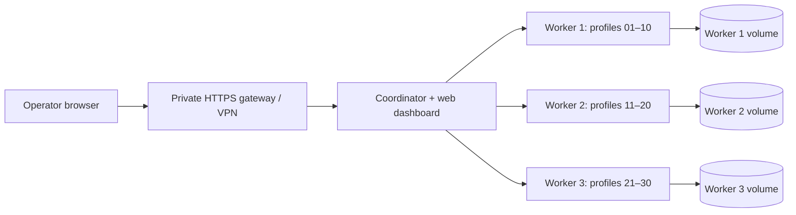

# Three-worker cloud deployment

This deployment provides **30 assigned profile slots**, split across three workers. Capacity claims are limited to the workload and duration in [CLOUD-PERFORMANCE.md](CLOUD-PERFORMANCE.md). Do not infer that every production website, VPS plan or 24-hour workload is validated.

## Architecture



The coordinator is a single control-plane instance. It routes each profile to one fixed owner, polls workers every three seconds, and applies a cluster-wide per-origin reload gate (one permit per 30 seconds). Worker-local 120-second cooldowns, randomized 120–300-second schedules, navigation/form safeguards and 429/503 backoff remain in effect. The coordinator denies permits for 30 seconds after restart and workers fail closed when the gate is unavailable. No central outage restarts browser sessions. This is not an active-active coordinator or automatic profile-migration system.

Workers run visible Chromium on separate Xvfb displays, with ten independently persistent contexts each. All 30 can be requested concurrently, subject to admission checks and actual server capacity. Each worker has its own volume and AES-256-GCM key for metadata/session-cookie checkpoints. Native Chromium storage, including localStorage and browser databases, is not fully application-encrypted: use encrypted disks/volumes and secure backups. These containers are for a single trusted operator, not mutually hostile tenants. Playwright's normal browser sandbox behavior is unchanged; use VM isolation/hardened browser sandbox configuration for untrusted workloads.

## Requirements and sizing

- Linux x64 host with Docker Engine, Docker Compose v2 and Node.js 22.12+/24 for setup/verification scripts.
- Start with the conservative **16 vCPU, 32 GiB RAM, 100 GiB SSD/NVMe** candidate in the performance report; validate with your own authorized workload before relying on it. This is a starting estimate, not an independently proven universal minimum.
- The Compose workers each have limits of **4 CPUs, 8 GiB RAM, 2,048 processes, 2 GiB shared memory**, a read-only root filesystem and 1 GiB temporary filesystem. The coordinator has a 1 CPU/512 MiB cap. Worker launches stop below 1 GiB available memory. Monitor disk use; browser volumes have no automatic disk-size quota.
- Allow access to the Docker Hub Node image, Microsoft Playwright image and its regional image-layer CDN, npm, and the websites you are authorized to use. A blocked image download does not validate the image or deployment.

## Install

From the repository root:

```sh
node deployment/setup.mjs
docker compose -f deployment/compose.yaml config --quiet
docker compose -f deployment/compose.yaml build
docker compose -f deployment/compose.yaml up -d
ADMIN_TOKEN_FILE=deployment/.secrets/admin-token node scripts/cloud-ready.mjs
docker compose -f deployment/compose.yaml ps
```

Setup creates independent 256-bit random tokens and encryption keys **without printing them**. Existing files are preserved. `deployment/.secrets` is ignored by Git. The directory is owner-only (0700); individual files are readable by container uid 10001 after Compose mounts them (0444). Keep the parent directory private. Back up the keys securely before storing real sessions; losing a key prevents recovery. Keys must remain stable across container rebuilds/restarts. This setup is intended for Linux filesystem permissions, not a shared workstation directory.

The dashboard binds to **127.0.0.1:3000 only**. Access it through a private SSH tunnel or an authenticated HTTPS gateway/VPN. Read `deployment/.secrets/admin-token` privately and enter it in the dashboard. The token stays in page memory, not localStorage. Worker HTTP ports are not published. Internal Docker bridge HTTP is explicitly enabled; for separate worker hosts use trusted HTTPS origins with valid certificates, private firewall rules and independently distributed token files. Never publish raw worker ports or the Docker socket. Do not add `--privileged`, disable TLS verification, or mount shared profile volumes across owners.

In the dashboard, save an assigned HTTPS site for each stopped profile, set reload options, then start the desired profiles. `Start assigned profiles` starts each worker's ten profiles in sequence, with the three workers proceeding concurrently. Auto reload is off initially. No site-specific online-status behavior, stealth, CAPTCHA bypass or platform evasion is implemented. A browser process being active does not imply that any website regards an account as online.

### Interactive cloud login

Xvfb is a virtual display, **not** a remote desktop. The dashboard controls processes; it does not stream browser pixels or submit credentials. Manual website login requires a separately secured remote desktop attached to each worker's display. Do not expose VNC/noVNC publicly. If remote desktop is required, provision it privately before using real accounts; the provided fixture tests need no accounts or remote desktop.

### Local Windows application

The original Electron application's local mode and resource limit remain unchanged. This fleet uses the coordinator's web dashboard. The old single-worker `compose.yaml` remains available; do not confuse it with `deployment/compose.yaml` or share its data with a cloud shard. Windows DPAPI vaults and previous 30-slot single-worker stores are not automatically imported into AES-encrypted ten-slot cloud shards.

## Verify readiness and capacity separately

`/health/live` is unauthenticated liveness only. `/health/ready` requires the dashboard token and means all configured **worker APIs** are ready, not that 30 browsers are active.

After starting all assigned browsers:

```sh
npm ci
npm run build
ADMIN_TOKEN_FILE=deployment/.secrets/admin-token npm run cloud:verify
```

`cloud:verify` exits nonzero unless all 30 unique assigned profiles are running and all workers are healthy. It does not assert page content or long-term performance on arbitrary sites. The dashboard shows each profile's state/reload settings and each worker's CPU, RAM, process count, last health result and crash/close count. CPU 100% means one core. Cgroup values are container-wide; process-tree RSS includes shared pages and is a conservative upper bound, not unique physical RAM. A native three-process lab shares a cgroup, so cgroup values must not be summed three times.

For an observation period on your already-started authorized fleet:

```sh
ADMIN_TOKEN_FILE=deployment/.secrets/admin-token \
DURATION_SECONDS=3600 REPORT_DIR=reports/local-production-observation \
npm run cloud:load
```

This samples health/status every ten seconds and writes timestamped JSONL and an atomically updated summary. It does not cause navigation or create accounts. A completed observation is not a functional website journey; run your own approved checks too. `completed:false`, failed samples or fewer than 30 running profiles do not pass.

## Recovery and operations

- Start/stop intent and reload pause intent are written atomically before/with control actions. A clean application/container restart restores profiles explicitly marked desired-running; intentionally stopped profiles stay stopped. This restoration necessarily navigates to the configured homepage. Do not enable restoration on sites where that request is inappropriate.
- Three automatic restore attempts per profile are permitted between explicit start/reset operations, using 30/60/120-second backoff. The budget and deadlines survive worker restarts. A blocked profile needs operator attention; `Stop` then `Start` clears its budget. There is no infinite browser-restart loop.
- Every worker starts through `scripts/cloud-worker.sh`, which holds a kernel `flock` on its own persistent volume. A duplicate owner exits with code 73. Never delete the lock file to force takeover. Never run `node dist/cloud-worker.cjs` directly or migrate a live volume.
- At startup, after acquiring the lock, the worker can terminate stale browsers bearing its persisted ownership marker **and** one of its exact assigned data-directory paths. Linux PID start-time checks guard against PID reuse. Unknown browser processes and unrelated data directories are not killed; Chromium SingletonLock files are not removed. Container teardown normally removes all old browser processes anyway.
- Tab crashes and unexpected context closes are counted, and desired profiles enter bounded recovery. Session-only cookies are encrypted and checkpointed every 30 seconds and before controlled shutdown. Persistent cookies/localStorage remain in the per-profile Chromium directory. Abrupt failure may lose changes since the last checkpoint, and site-side logout/expiry still applies.
- Docker restarts exited containers. Docker health checks **do not automatically restart a merely unhealthy/hung container**. Alert on an unhealthy worker, missing desired profiles, memory pressure, sustained CPU saturation or disk pressure, then investigate/restart that worker safely.

```sh
docker compose -f deployment/compose.yaml logs --tail=100 worker-1
docker stats
docker compose -f deployment/compose.yaml restart worker-1
```

Keep only one coordinator active. After a restart, run readiness verification, then verify the expected desired profiles. Never treat a PID or open TCP port as proof of page functionality.

### Backups and upgrades

Stop all profiles, then stop the deployment before making encrypted backups of all three data volumes and the secret directory. Use an offline backup mechanism appropriate to your encrypted storage. Restore each volume with its original worker identity, assignment and encryption key. Upgrades use `docker compose ... build` and `up -d` without deleting volumes. `docker compose ... down` retains data; **`down -v` deletes it**. No automatic backup, live failover or cross-worker replication is provided.

## Automated fixture integration and load test

The Linux laboratory starts three real, independently locked worker processes plus a coordinator. All browser traffic is intercepted at the reserved `https://fixture.invalid/` origin, serving an application-owned HTML/JavaScript fixture; no external website or account is contacted. The fixture executes a two-millisecond task every second and updates a DOM counter. Thirty contexts receive different synthetic cookies/localStorage values. Probes test persistence/isolation, actual JavaScript progress, health, duplicate-owner rejection, tab crashes and worker-process loss. Test-only endpoints are authenticated and absent in production; `MBAM_TEST_MODE=1` is rejected with `NODE_ENV=production`.

```sh
npm ci
npm run build
npm test
npx playwright install --with-deps chromium
DURATION_SECONDS=180 REPORT_DIR=reports/local-fixture-run \
xvfb-run -a npm run test:cloud
```

Use a fresh report directory. An existing system Chromium can be selected with `TEST_CHROMIUM=/usr/bin/chromium`; identify its version in your report. Fixtures are intentionally lightweight; they do not approximate every real web app, video conference or media stream. The native process lab is distinct from Docker runtime validation.

The `Validate cloud worker fleet` GitHub workflow builds the image, boots the Docker control plane, and runs the native 30-browser fixture test on a Linux runner. Its report artifact excludes private tokens, browser data and encryption keys. Runner resource limits can make the capacity test fail; a failed test is not silently reduced to fewer browsers.

## 24-hour endurance

A genuine 24-hour result requires a persistent, dedicated host with sufficient resources. GitHub-hosted jobs have a shorter job limit, so the separate manual `Cloud 24-hour endurance (dedicated runner)` workflow requires a trusted self-hosted Linux x64 runner labeled `mbam-endurance`. Provision that runner yourself; no runner was registered automatically. Do not expose it to untrusted pull-request code.

Alternatively, on a persistent Linux desktop/Xvfb host:

```sh
DURATION_SECONDS=86400 REPORT_DIR=reports/endurance-your-run \
xvfb-run -a npm run test:cloud
```

Check `summary.json` while it runs; `completed:false` is not a pass. After the duration, the harness runs recovery checks, writes `integration.json`, and stops only its own laboratory processes. Require both a completed zero-failure summary and a completed integration result. On interruption, a partial report remains; do not relabel it as a full 24-hour test. The ephemeral onboarding workspace may be suspended or destroyed before a background test finishes. See the performance report for the exact status of any run started in this task.

For a background laboratory created in this workspace, inspect or stop it safely with PID-reuse checks:

```sh
node scripts/stop-cloud-lab.mjs reports/endurance-20261017 --status
node scripts/stop-cloud-lab.mjs reports/endurance-20261017
```

The second command requests graceful shutdown; it does not delete profile data or label the partial run as passed.
